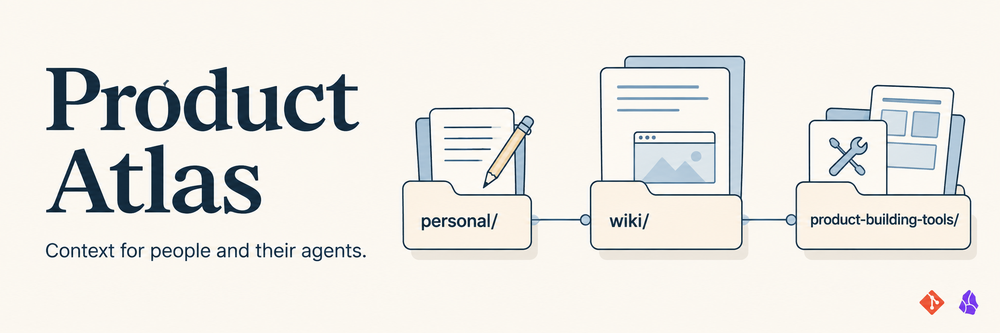

A workspace for product context, richer PRDs and reusable PM tools, shared between people and their agents.

[Read how Product Atlas came to be](https://www.gouthamg.com/Projects/Product-Atlas): the evolution from a personal folder to HTML artifacts and a shared product wiki.

## Start with your agent

Clone or download this repo, open it in Claude Code, Codex or another agent, and say:

> Read setup.md, explain how Atlas works, and help me set it up for my product.

The agent will learn your context, create the workspace and tailor the rules. There are no setup scripts or packages to install. The optional Figma CLI uses Python 3.

## Three places for the work

| Folder | Purpose |
| --- | --- |
| `personal/` | Your inbox, drafts and work in progress. Ignored by Git. |
| `wiki/` | Shared product docs, PRDs, research, meetings, decisions and plans. Its own Git repository. |
| `product-building-tools/` | The templates, checklist, guides, skills and tools PMs reuse. |

The first two folders are created during onboarding. Only `wiki/` should feed a shared site if you choose to add one later.

## What's included

- [AGENTS.md](AGENTS.md) and [rules](rules/) for the workspace and its document types.
- [Templates](product-building-tools/templates/) for PRDs, product docs, meetings, decisions, competitor notes and checklists.
- A [feature-completeness checklist](product-building-tools/checklists/feature-completeness.md).
- [Portable skills](product-building-tools/skills/) for requirements, meeting records, design reviews and competitor research.
- A [Figma CLI](product-building-tools/guides/working-with-figma.md) to capture a section's frames and context without MCP.

Instructions use [AGENTS.md](https://agents.md/) and the open [Agent Skills format](https://agentskills.io/specification). If your client doesn't discover a skill automatically, ask it to read the relevant `SKILL.md`. Skills use shared Atlas resources, so keep them in this workspace.

Keep credentials out of tracked files. Private folders are ignored, not encrypted. No accounts, remote wiki, publishing, hosting or background jobs are configured by this starter.

## License

[MIT](LICENSE) © 2026 Goutham Ganesan.

Git and Obsidian marks belong to their owners. This project is unaffiliated; Obsidian is optional.
